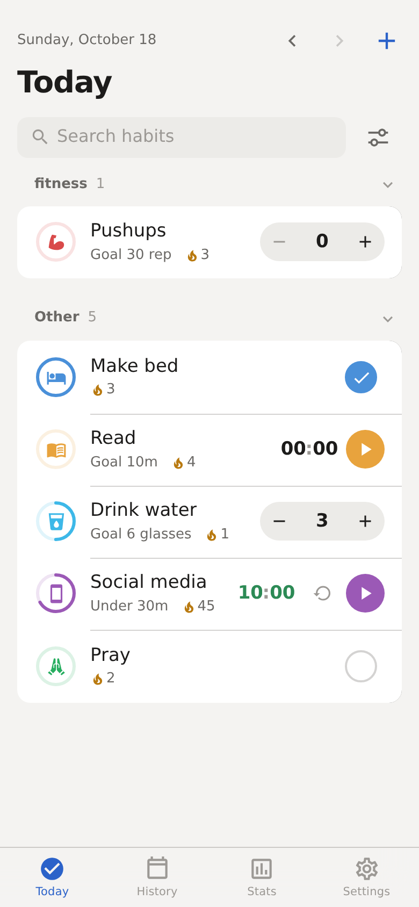
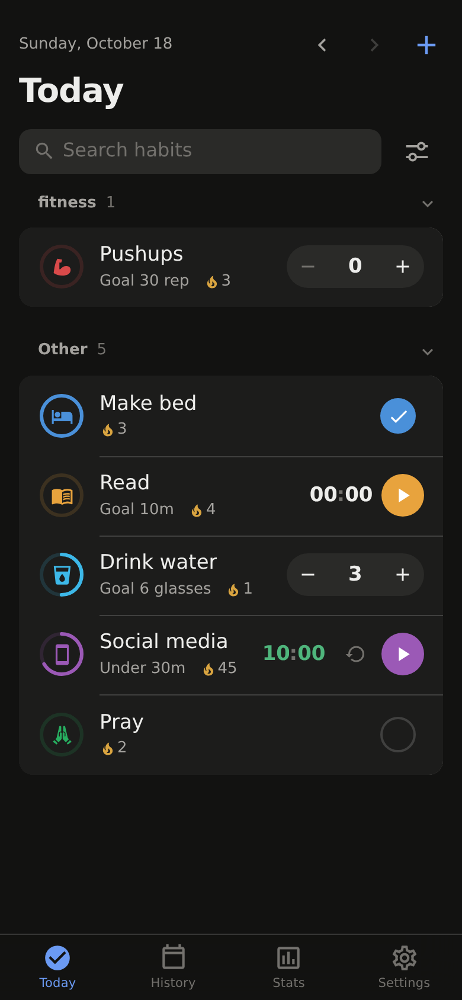
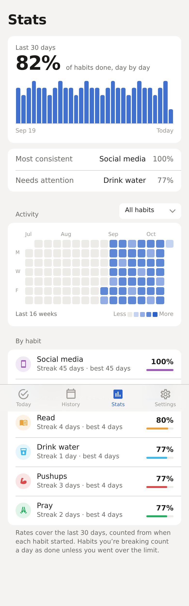
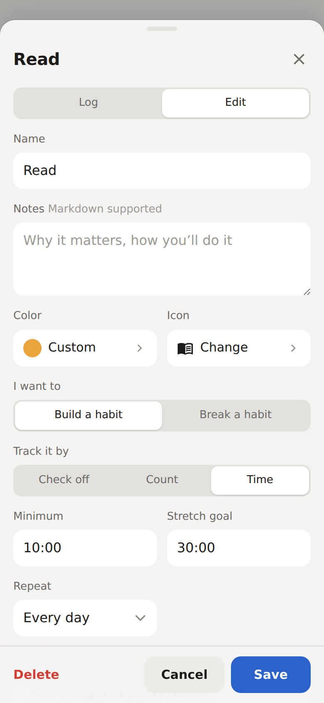
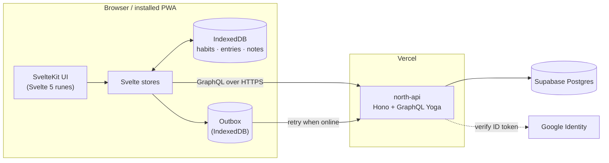

# North

North is a habit tracker built around a simple idea: you become who you want to be through small things done consistently. It's an installable, offline-first web app with an optional account for syncing across devices.

**Live:** [north-mu.vercel.app](https://north-mu.vercel.app)

<p>
  
  
  
  
</p>

## Features

- **Flexible habits.** Check-off, count (glasses of water, pages) or timed habits, each with a minimum and an optional stretch goal. Habits can be ones you're *building* or ones you're *breaking*, where staying under a limit counts as success.
- **Schedules.** Every day, N days per week, weekly, monthly or every few days, with a configurable start of week and a configurable time the day rolls over.
- **Habit relationships.** *Conditional* habits complete themselves when the habits they depend on are done. *Linked* habits share one log, so a single entry counts toward each.
- **Built-in timer** for timed habits, plus quick-step buttons and a drag-to-adjust ring for fast logging.
- **History and backfill.** Edit any past day from a scrollable grid, or fill in a range of days with conditions (skip weekends, only on days another habit was done, and so on).
- **Stats.** 30-day completion, a per-day breakdown, a 15-week activity heatmap, streaks and per-habit rates.
- **Notes** attached to one or more habits on a given day, with Markdown and search.
- **Accountability partners.** Invite someone with a link, choose which habits they can see, and view theirs.
- **Automation.** Per-user API keys for iOS Shortcuts and other tools, and per-habit webhooks and Shortcut triggers that fire when you log, hit your minimum or reach your stretch goal.
- **Works offline, no account required.** Everything runs on-device; signing in with Google adds backup and multi-device sync.
- **Themes.** Light, dark, true-black OLED, or by time of day, with a custom accent color and background tint.

## Architecture



The app and the API are deployed as two Vercel projects from this repository: the SvelteKit frontend at the root, and the API in [`backend/`](backend).

## Engineering notes

**Offline-first sync.** IndexedDB is the source of truth for the UI, so every interaction is instant and works without a connection. Writes go to IndexedDB first and are then pushed to the API. Network failures land in a durable outbox (a separate IndexedDB database) that drains when connectivity returns. When the app regains focus or comes back online, it pulls a fresh snapshot and merges it with local data, last-write-wins per record (entries are keyed by habit + date). Each collection's cache is rewritten in a single IndexedDB transaction, so the UI never sees a half-written state. A sync watermark tells "created offline, not uploaded yet" apart from "deleted on another device", so deletions propagate without losing unsynced work.

**API design.** A GraphQL API (GraphQL Yoga on Hono, running as a Vercel function) with Relay-style opaque global IDs, plus cursor and offset pagination with a stable tie-breaker so pages don't shift under concurrent writes. The API talks to Postgres with a service role, so authorization is enforced explicitly in every resolver: queries are scoped to the caller, and upserts refuse to touch rows owned by someone else. Sign-in verifies Google ID tokens against Google's published keys and issues the app's own signed session token. API keys resolve to a specific user, so external tools see exactly what the owner sees.

**Domain logic shared by client and server.** Success rules are defined once and mirrored on both sides: build habits succeed at or above a threshold, break habits at or below it, and timed habits are stored in seconds. Linked habits form symmetric groups that both client and server normalize, so unlinking on one device can't leave the group lopsided. Conditional habits auto-complete and cascade when their dependencies change.

**Honest statistics.** Completion rates count missed days, not just logged ones. Each habit is measured from the day it started, days-per-week habits are scored against their weekly target, and break habits count a day as successful unless a logged value went over the limit.

**Design system.** All styling runs through a small set of semantic tokens (surfaces, text, separators, accent, status colors, spacing, radii), defined for light, dark and OLED. The accent and background-tint pickers rewrite those tokens at runtime, so every screen follows the user's palette with no per-component theming code. Modals are bottom sheets on phones and dialogs on larger screens; respecting reduced motion and keeping visible focus states are part of the base styles.

## Tech stack

| Area | Tools |
| --- | --- |
| Frontend | SvelteKit 2, Svelte 5 (runes), TypeScript, Vite |
| Local data | IndexedDB via `idb` |
| API | Hono, GraphQL Yoga, TypeScript |
| Database | PostgreSQL on Supabase, SQL migrations in [`supabase/migrations`](supabase/migrations) |
| Auth | Google Identity Services, JWT sessions (`jose`), per-user API keys |
| Hosting | Vercel (frontend and serverless API) |

## Project structure

```
src/
  routes/          Pages: today, history, stats, settings, accountability, admin, api-docs
  components/      Habit row, sheets/modals, pickers, heatmap, progress ring
  stores/          Svelte stores for habits, entries, notes, auth, roles, theme
  services/        Sync provider, outbox, data loader, habit engine, analytics, webhooks
  lib/             Shared logic: thresholds, streaks, dependencies, dates, GraphQL client
  styles/          Design tokens and base styles
backend/
  src/schema.ts    GraphQL schema
  src/resolvers/   Habits, entries, notes, identities, settings, accountability, API keys, users
supabase/
  migrations/      Database schema history
```

## Running locally

Requires Node.js 22 or newer.

```sh
# Frontend
npm install
cp .env.example .env          # set PUBLIC_API_URL and PUBLIC_GOOGLE_CLIENT_ID
npm run dev                   # http://localhost:5173

# API (in a second terminal)
cd backend
npm install
cp .env.example .env          # Supabase URL + service role key, JWT secret, Google client ID
npm run dev                   # runs the function locally with `vercel dev` (needs the Vercel CLI)
```

The app works without the API: habits are stored on-device and sync starts once you sign in. To create the database schema in your own Supabase project, run `npm run db:migrate`.

Useful scripts: `npm run check` (svelte-check type checking), `npm run build`, `npm run lint`.

## API

The full GraphQL reference, with copy-paste examples in curl, Python and JavaScript, is built into the app at [`/api-docs`](https://north-mu.vercel.app/api-docs). Create an API key in Settings and send it in the `x-api-key` header.
